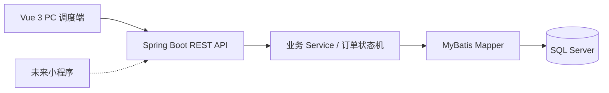
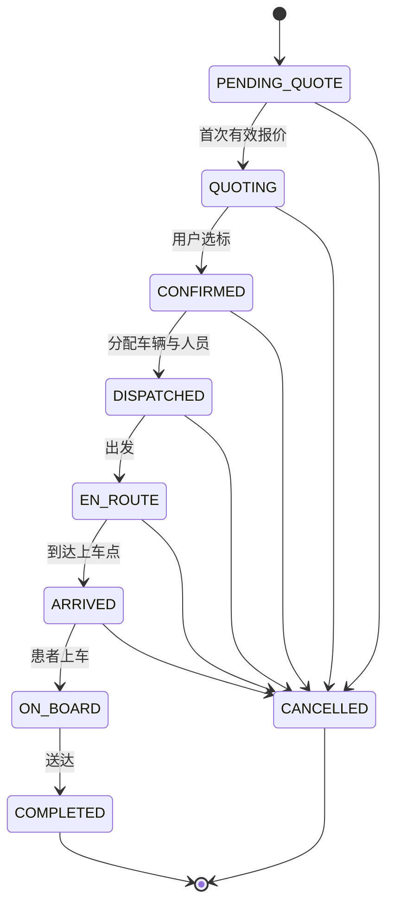

# 架构与阶段安排

## 需求来源与技术选择

原始依据：`文档存放/基础大纲.docx`。采用单仓库：PC 调度端和未来小程序共用 Spring Boot 后端。数据库使用 SQL Server，持久层使用 MyBatis；Spring Security + BCrypt + JWT 提供登录与角色控制。

PC 端通过 Vue Router 校验角色并显示对应导航；JWT 存在标签页 sessionStorage，401 清理凭据并返回登录页。基础资料、模拟下单、订单池、报价、派车、司机任务与订单监管已接入真实接口；订单列表和详情复用 OrderBoard / OrderDetails，每 10 秒轮询，页面卸载后停止。人员管理复用 StaffManager，派车表单使用 DispatchForm。

## 已完成与后续

| 阶段 | 内容 | 当前状态 |
| --- | --- | --- |
| 0 | 工程骨架、健康检查、页面导航、SQL Server 脚本 | 已建立 |
| 1 | JWT 登录、角色隔离、车行审核、车辆资料、调度账号与基础统计 | 已完成 |
| 2 | 模拟下单、资质过滤、订单池、报价与选标、订单监管 | 已完成 |
| 3 | 人员与司机账号、派车、司机节点、时间轴、送达释放 | 已完成 |
| 4 | 取消、取消资源释放与进一步隔离回归 | 待开发（并发选标、派车竞争及基本隔离已验证） |
| 5 | 费用留痕、基础统计、批量回归 | 待开发 |

角色隔离和车辆所属车行限制已随业务接口实现，通过真实 SQL Server 集成测试验证；阶段 4 继续补齐订单层面的完整隔离验证。默认仅监听本机地址。

### 阶段 1 的业务规则

- 首位管理员通过启动参数初始化，已有管理员时不覆盖；管理员可创建指定车行调度账号。
- 车行新建与修改后处于 PENDING；只有 PENDING 可以审核。REJECTED 必须提供原因，APPROVED 需要非空且未过期的资质到期日。
- 已通过但资质到期的车行在查询和统计中按 EXPIRED 处理，不依赖定时任务。
- 管理员可维护任意车行车辆；调度员接口只取当前账号的 companyId，忽略客户端自报身份。
- 车辆可手工维护 IDLE / MAINTENANCE，TASK 留给后续履约流程控制。任务车辆禁止编辑或删除；引用记录由外键保护。
- 默认业务接口拒绝访问；每次请求重新校验启用状态及角色，JWT 过期两小时。资质日期按 Asia/Shanghai 判断。

## 订单状态约定

### 阶段 2 的业务规则

- 模拟下单默认关闭，仅管理员可在启用后使用。创建日志的 MOCK_USER / operator_id 保存创建者，列表、详情和选标按创建者隔离。监管接口允许管理员只读查询全局订单。
- 开放订单为 PENDING_QUOTE / QUOTING；车行须审核通过、资质有效且有同等级空闲车辆才能在池中看到并报价。不使用地图距离过滤。
- 每车行每订单一条报价，订单确认前可修改，首笔报价进入 QUOTING；报价变更记录 FEE_CHANGE 日志。车行只能看自己的报价，不能通过详情日志取得其他车行的报价。
- 报价与选标依次锁定订单、车行及匹配车辆；选标重新检查资质和车辆，并核对用户看到的金额。同时更新订单确认金额、全部报价 WON / LOST 及状态日志。10 请求并发选标已通过真实 SQL Server 验证。
- 选标后不允许再次报价或选标；车辆此时尚未分配或占用，派车阶段继续校验。取消流程留待后续阶段。
- 列表和详情每 10 秒刷新；报价编辑和选标确认期间暂停详情轮询，离开页面后停止。时间存储为 UTC，界面转为本地时区。

### 阶段 3 的业务规则

- 管理员及所属车行调度员可维护司机和护士。司机使用 BCrypt 密码登录；护士无需登录账号。人员角色与登录名创建后不变，响应不包含密码及哈希。
- 仅中标车行可派车。锁定顺序为订单 → 车行 → 车辆 → 人员；车行锁串行化同车行的资源分配、人员修改和任务完成，资源状态及订单状态使用条件更新。
- 派车重新检查车行资质、精确车辆等级、IDLE 状态、人员所属车行、角色、启用状态、证书编号与有效期。监护型必须配备护士；基础型可选配。
- 车辆 TASK 表示占用；司机和护士的忙碌由 DISPATCHED / EN_ROUTE / ARRIVED / ON_BOARD 的关联订单判定。执行任务中的人员不能修改、停用或删除，历史关联由外键保护。
- 司机只能推进本人且同车行的任务，依次出发、到达、上车、送达；不能跳步或重复操作。已派车后证书或车行资质到期不阻止当前转运完成。完成订单和释放车辆在同一事务提交，人员随完成恢复可用。
- 订单详情与监管保留资源和状态时间轴；司机不接收报价费用日志，落标车行看不到中标车行的车辆和人员指派。响应过滤使用订单副本，避免修改 MyBatis 缓存对象。
- 真实 SQL Server 测试覆盖三次连续完整履约与车辆、司机、护士三类资源的并发竞争。页面操作期间暂停详情轮询，冲突后刷新并要求重新选择资源。

骨架默认患者上车后不允许普通取消；若需要处理中途终止，应增加专门的异常流程。创建订单需在同一事务写入首条 `from_status=NULL` 日志。报价选择需锁定/条件更新同一订单行，并同步中标、落标、金额和日志；仅分别更新报价记录不足以避免多报价同时中标。

派车和送达释放已实现；取消时的原因记录和资源释放待阶段 4 实现，状态图中的取消箭头目前仅为状态机约定。所有已实现的业务状态修改经过状态机、数据库事务及条件更新，并写日志；数据库 CHECK 只校验状态值，不校验业务流转路径。

PC 阶段继续暂缓真实地图路径、支付、WebSocket、多城市和小程序授权。
